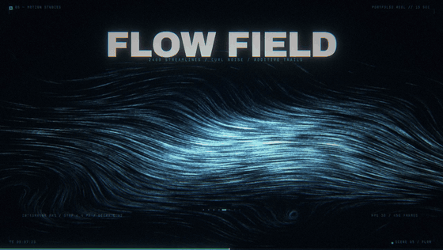
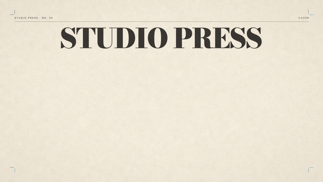
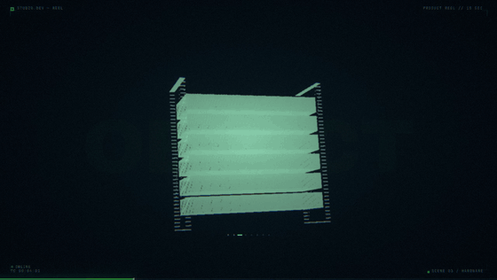
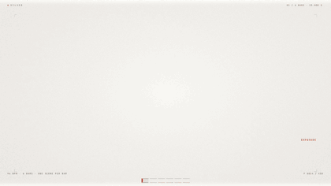
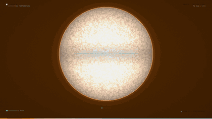
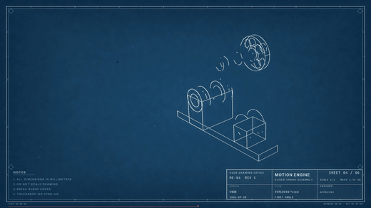
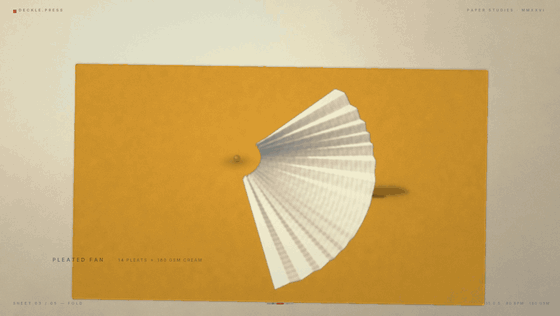
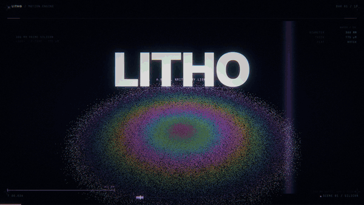
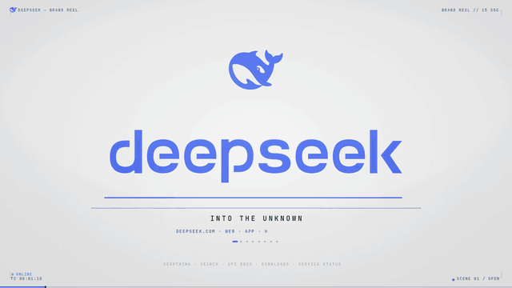
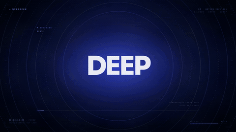

# RuiC-motion-reel

**一句话进去，一条片子出来 —— 样式现场推，不从模板库里挑。**

```bash
python3 scripts/new_reel.py ~/my-film --brief "做一条 20 秒的咖啡品牌片，暖色胶片感，慢"
```

这句话被读成六个量（**时长 / 画幅 / 冷暖 / 质感 / 节奏 / 语言**），再推出
**色板、字体对、运动语法、分镜骨架**，写进工程的 `SPEC.md` 与 `theme.py`。
换一句话就是另一套样子——不参考本仓库里任何一支历史片。
画面和音乐全部由代码产出：不依赖外部美术素材，也不打开 After Effects。

| 一句话 | 推出来的样子 |
|---|---|
| 20 秒咖啡品牌片，暖色胶片感，慢 | 6 小节 @72 BPM · 暗底 · 琥珀 `#C98036` · 衬线标题 · 颗粒 + halation |
| 竖屏 30 秒，冷色科技感，快，霓虹 | 10 小节 @80 · 1080×1920 · 暗底 · 电青 `#0FACF0` · 粗无衬线 · 扫描线 |
| 12 秒，瑞士极简，白底，黑字，克制 | 8 小节 @160 · 亮底 · 中性蓝 `#247FDB` · 大衬线 + 无衬线 · 只有发丝线 |
| 45 秒产品发布，印刷质感，riso 双色 | 12 小节 @64 · 亮底 · riso 粉 `#D42B63` · 网点 + 套印偏移 + 纸纹 |

片长由音乐网格算出来，不是"感觉差不多"：

| 片长 | 小节（=镜头数） | BPM | 每小节 | 适合 |
|---|---|---|---|---|
| 12 s | 8 | 160 | 1.500 s | 纯冲击，无叙事 |
| 15 s | 8 | 128 | 1.875 s | 作品集样片、单点 demo |
| **24 s** | **12** | **120** | **2.000 s** | **宣传片起点：三个 act** |
| 30 s | 10 | 80 | 3.000 s | 需要一点呼吸的品牌片 |
| 45 s | 12 | 64 | 3.750 s | 产品发布、功能串烧 |
| 60 s | 15 | 60 | 4.000 s | 开场短片、展会循环 |

`seconds = bars × 240 / BPM`，两条路线都从这张表取值。

下面那张表是引擎**做过**的样子（暗色 HUD / riso 印刷 / 纸艺 / 银盐 / 普朗克 / 蓝图 /
光刻 / 品牌亮色）——**是历史，不是可选清单**。新片一律从一句话推，不抄这些格子。
完整成片在 [`docs/films/`](docs/films/)。

> **本 skill 由作者用 DeepSeek Flash 跑通**：从建模、排版、分色到配乐与出片，
> 整条链路都是它自己跑出来的。
> **不绑定模型** —— 支持各大主流多模态模型，任何能读写文件、执行命令的编码 Agent 都能用。

这是一个 Agent Skill（给 ZCode / Claude Code 这类编码 Agent 用）：装上之后，
一句「用代码做一条 15 秒动态图形片」就能从零到出片。

| 暗色科技 · 流场 | 丝网印 / riso · 封面 | 3D 建模 · 点云渲染 |
|---|---|---|
|  |  |  |
| **银盐 / 暗房 · SILVER** | **恒星 · KELVIN** | **氰版蓝图 · MOTION ENGINE** |
|  |  |  |
| **纸艺 · DECKLE** | **紫外光刻 · LITHO** | **品牌亮色产品片 · BRAND LIGHT** |
|  |  |  |

> 另外还有一支 **24 秒动效宣传片**（[`promo-deepseek-24s.mp4`](docs/films/promo-deepseek-24s.mp4)，1080p60 / 120 BPM × 12 小节），
> 走的是仓库里的 `remotion/` 路线：12 个镜头、全片文字与配乐都是代码写的，不是 15 秒模板拉长。
> 
>
> 同系列的 **DeepSeek** 品牌片（[`brand-light-demo-15s.mp4`](docs/films/brand-light-demo-15s.mp4)，Python 路线）：
> 鲸鱼标与字标取 deepseek.com 官网内联 SVG 的原路径（不是重排的近似字体），
> 色值逐条取自其设计 token（`--ds-color-brand` `#4d6bfe` 等），产品界面按其亮色主题自绘。
> **这是用本引擎做的排版与管线演示，与 DeepSeek 无隶属关系，商标归其所有者。**


## 它能做什么

- **任意时长的成片**，锁在音乐网格上（`seconds = bars × 240 / BPM`），每个场景一小节，
  **每一次剪辑都落在强拍上**；`BARS` 不必等于场景数（场景会自动循环铺满）
- **字体排版**：2× 超采样矢量/文字通道、字距排版、字号按目标宽度反解
- **真 3D**：参数曲面建模 + 点云渲染（排序散射做精确遮挡）+ 隐藏线线刻
- **印刷管线**：分色成四块油墨版、旋转网线做网点、乘法定律叠印、
  套印偏移、纸纹、裁切线、套准规
- **配乐合成**：打击乐 / 贝斯 / FM 电钢 / 钟 / 铺底 / riser / impact，
  加磁带抖晃与混响，无采样
- **颜色也能是被算出来的**：给一个物理量就直接得到颜色——黑体温度
  （Planck → CIE 1931 → sRGB）、谱线波长、薄膜干涉（氧化层厚度 → 反射光谱）。
  LITHO 里曝光光是 405 nm 反解的那支紫，晶圆彩虹是 SiO₂ 厚度 20–780 nm 积分出来的
- **样式从句子推，不抽牌**：冷暖定基色相、质感定主色与后期、节奏定密度，
  色板只有"基色相"一个自由度，其余明度同源。16 张卡降级为参考库（`--style <id>` 才用）
- **出片链**：多进程逐场并行渲染 → H.264 编码 → 混音，1080p30 的 15 秒约 3~8 分钟（排版重的牌更久）

## 安装

```bash
git clone https://github.com/HRuiCcc/RuiC-motion-reel.git \
  ~/.agents/skills/ruic-motion-reel
```

依赖：`python3`（numpy + Pillow）、`ffmpeg`。字体随包（OFL）。

```bash
pip install numpy pillow
```

## 用法

**给 Agent 用**（推荐）：把 skill 装到 `~/.agents/skills/` 下即可，
Agent 会在你说「用代码做个动效视频 / 生成一条 15 秒作品集样片 / 给某个品牌做一条片子」时自动使用它。

**手动用**：

```bash
# 主入口：一句话起片（写 SPEC.md / SPEC.json，并把色板、网格、画幅改进 theme.py）
python3 ~/.agents/skills/ruic-motion-reel/scripts/new_reel.py ~/my-film --brief "一句话需求"

# 只要一份中性模板 / 自己指定片长
python3 ~/.agents/skills/ruic-motion-reel/scripts/new_reel.py ~/my-reel --name my_reel
python3 ~/.agents/skills/ruic-motion-reel/scripts/new_reel.py ~/my-promo --seconds 24

cd ~/my-film
# 看 SPEC.md：片长/画幅/冷暖/质感/节奏/分镜骨架都在这
# 补 my_film/theme.py 里的身份与文案（色板/网格/画幅 brief 已经改好了）
# 写 my_film/scenes.py：按 SPEC 的分镜骨架一场一场画

python3 -m my_reel.build --stills 0     # 抽一场的 7 帧审阅
python3 -m my_reel.build --at 3:1.20    # 某一拍的单帧全分辨率
python3 -m my_reel.build                # 出全片
```

产物在 `out/`。

## 仓库结构

```
SKILL.md               Agent 的主工作流（触发条件、流程、硬规矩）
engine/                共享渲染引擎
  core.py              画布、矢量文字通道、bloom/色差/颗粒、
                       印刷原语（叠印 multiply、网点、纸纹、套印偏移）
  three.py             3D：参数曲面、相机、点云渲染、隐藏线
  fonts.py             字体栈、字距排版、基线换算、字号反解
  anim.py              缓动、错帧、值噪声
  dsp.py               合成器 DSP：FFT 时变滤波、磁带抖晃、混响、频谱分析
template/              可跑的最小工程（8 个场景 + 一段配乐）
scripts/brief.py       一句话 -> SPEC：时长/画幅/冷暖/质感/节奏 -> 色板、字体、分镜骨架
remotion/              24 秒宣传片的 Remotion 路线（React 组件 + 浏览器渲染，60fps）
scripts/
  new_reel.py          从模板起一支新片（默认抽一张风格牌，写进项目 STYLE.md）
  style_lottery.py     16 张视觉语言的牌堆，抽签 / 列牌 / --avoid 上一张
  preview_gif.py       成片或帧序列 → README 用的循环预览 GIF
  perf_probe.py        逐算子 CPU vs CuPy，看换显卡到底能省多少
references/
  style-synthesis.md   一句话 → 一套视觉：六个量怎么读、色板怎么反解、六个质感的语法
  promo-brief.md       一句话 brief → 分镜：片长选型、16 项要素表、24 秒 12 刀模板
  remotion-default.md  为什么常规成片默认走 Remotion、显卡到底在哪一步出力
references/            按需加载的细节文档
  design-grammar.md    设计语法：时间网格、排版、构图、动效、亮度校准
  three-d.md           3D 引擎用法与配方
  print-pipeline.md    分色、网点、叠印、版面家具
  audio-dsp.md         配乐合成
  gotchas.md           踩过的坑（近 40 条，症状与真因）
  performance.md       一帧花在哪、换显卡能省多少（实测）
assets/fonts/          随包字体（OFL 1.1，见 NOTICE.md）
assets/wechat-donate.png  赞赏码
```

## 设计上的几个立场

**时间先有网格，再有镜头。** 「剪辑点落在强拍上」不是后期对轴对出来的，
是结构决定的——一个小节一个场景，所以音乐和画面共用一条时间轴。

**3D 不用三角形光栅化器。** Python 里逐三角形太慢；把曲面密采样成点云、
投影后按深度排序散射（numpy 对重复下标保留最后一次写入 = 画家算法），
遮挡精确、无逐三角形循环，而且密集点云自带颗粒感——铜版雕刻也是这个原理。

**颜色是被算出来的，不是被指定的。** 印刷管线把明暗拆成几块油墨版，
各自用不同网线角度做网点，再以乘法叠印。粉压蓝是真紫、黄压蓝是真绿——
中间调是油墨自己叠出来的。

**品牌色必须实测。** 官网样式表、产品截图，不要凭印象挑。
亮色品牌的暗色版不是另选一套色，而是把同一套色读到曝光的另一端。
品牌 logo 同理——取官网的原始 SVG/PNG，不要手画，也不要把字标重排成「像 logo 的字体」。

**亮底片的后期是反的。** 暗场里 bloom 阈值 0.68 就够，亮场要抬到 0.99（纸白本身 0.97），
品牌色满幅时甚至要抬到 1 以上（品牌蓝的 B 通道 0.996 会把自己的底板点着）。阈值低于底板亮度，整帧就被自己的底色洗白——**这个症状看起来像调色不对，真因在阈值**。

## 已知的坑都写在代码注释里

`references/gotchas.md` 有 40 多条，每条都是真踩过的，而且症状都不指向真因。举三个：

- PIL 的字形包围盒是相对 **ascender** 而非基线，按字高居中会整体低一个字身（168px 字号偏 147px）
- 重叠相加滤波要除以**窗和**（窗只加了一次）；除以窗平方和会引入 2× 纹波，
  且首尾样本会把舍入噪声放大上千倍
- AAC 编码后**采样间峰值超过采样峰值**，采样峰值定 0.92 会得到 +0.3 dBTP（已超 0 dBFS）

## 赞赏支持

<div align="center">
  
  <p><strong>微信扫码赞赏</strong></p>
</div>

---

## 协议

代码 MIT（见 `LICENSE`）。随包字体为 SIL Open Font License 1.1，
版权与协议见 `assets/fonts/NOTICE.md` 与 `assets/fonts/OFL.txt`。
